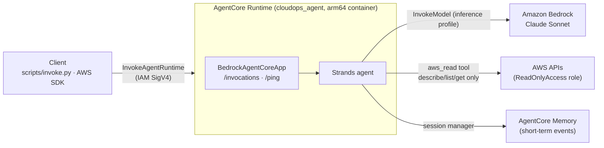

# AWS CloudOps Agent

A **read-only** AWS CloudOps assistant built with [Strands Agents](https://strandsagents.com) and
served on **Amazon Bedrock AgentCore Runtime**. It answers questions about your AWS account,
helps troubleshoot, and gives architecture and operations advice. It cannot change resources.

This repo is the base for the DevOps team's AI-agents hackathon. New tool sets (Spacelift,
Slack, …) plug into `src/cloudops_agent/tools/` without re-plumbing anything.

**New to the repo?** Start with **[docs/ONBOARDING.md](docs/ONBOARDING.md)**. It has the
component, request-flow, AWS architecture and CI/CD diagrams, plus a first-day checklist. It
links to the detailed reference docs in [`docs/codebase/`](docs/codebase/).

## Architecture

### Initial Architecture


> This is the original design diagram (source: `docs/aws_agent.drawio`). It also shows parts that
> have since moved to [`legacy/`](legacy/README.md): the Cognito auth, the AgentCore Gateway, and
> the Knowledge Base/RAG tools. The current runtime is the diagram below. A
> current AWS diagram with official icons is in
> [`docs/diagrams/aws-architecture.drawio`](docs/diagrams/aws-architecture.drawio).

### Current Architecture



- `src/cloudops_agent/app.py` validates the payload and streams the agent's text as SSE.
- `src/cloudops_agent/agent.py` builds the agent: the Bedrock model, the `aws_read` tool, the
  system prompt, a summarizing conversation manager, a current-time context injector, and
  AgentCore Memory when both `MEMORY_ID` and a session ID are present.
- Default model: **`global.anthropic.claude-sonnet-5-5`**. This was the newest Claude Sonnet-class
  inference profile listed in `ap-southeast-1` on 2026-11-12
  (`aws bedrock list-inference-profiles --region ap-southeast-1`).

## Prerequisites

- [uv](https://docs.astral.sh/uv/) 0.11+ (it installs Python 3.13 for you)
- Docker with `buildx` (the image is `linux/arm64`)
- Terraform ≥ 1.15
- AWS CLI v2 and credentials for the target account
- Bedrock model access to the chosen Claude model in the region. On first use, Anthropic
  models may need a one-time Marketplace subscription by an account admin.

## Project Structure

```ini
aws-cloudops-agent/
├── src/cloudops_agent/                 # Agent package (the only code in the container image)
│   ├── app.py                          # AgentCore entrypoint: validate payload, stream text (SSE)
│   ├── agent.py                        # build_agent(): model, tools, prompt, memory, conversation mgr
│   ├── config.py                       # Settings loaded from environment variables
│   ├── prompts.py                      # System prompt (read-only rules)
│   ├── logging_setup.py                # JSON-line logging to stdout
│   └── tools/
│       └── aws_read.py                 # Read-only boto3 tool (allow/deny, redact, truncate)
├── scripts/
│   └── invoke.py                       # Chat client: local server or deployed runtime
├── tests/                              # pytest unit tests (no AWS calls)
├── infra/                              # Terraform: AgentCore runtime, endpoint, memory, IAM, logs
│   └── bootstrap/                      # Terraform (run once): state bucket, GitHub OIDC, deploy role, ECR
├── .github/workflows/
│   ├── ci.yml                          # Lint, test, Terraform checks, trivy, gitleaks, Docker build
│   └── deploy.yml                      # OIDC deploy: push image, terraform apply (needs approval)
├── docs/
│   ├── ONBOARDING.md                   # Start here: diagrams + first-day checklist
│   ├── codebase/                       # Reference docs: stack, structure, architecture, …
│   ├── diagrams/                       # Current AWS architecture diagram (draw.io + PNG)
│   ├── aws_agent.drawio(.svg/.png)     # Initial architecture diagram
│   ├── aws-strands-agent.drawio(.svg)  # Initial agent diagram
│   ├── AWS-CloudOps-Agent.pptx         # Presentation
│   └── ROADMAP.md                      # Project roadmap
├── legacy/                             # Previous implementation (unmaintained, not built or deployed)
├── Dockerfile                          # arm64, non-root image for AgentCore Runtime
├── pyproject.toml                      # Project config, dependencies, ruff/pytest settings
├── uv.lock                             # Dependency lock file
├── .env.example                        # Local configuration template
├── .gitleaks.toml / .gitleaksignore    # Secret-scanning config
├── .pre-commit-config.yaml             # gitleaks, ruff, terraform fmt hooks
├── CLAUDE.md                           # Guidance for Claude Code
└── README.md                           # This file
```

## Local development

```bash
uv sync                                   # install deps (incl. dev tools)
uv run pytest                             # unit tests (no AWS calls)
uv run ruff check . && uv run ruff format --check .

# Run the agent on http://localhost:8080 (uses your AWS credentials for Bedrock + aws_read)
uv run python -m cloudops_agent.app
# Optional: put settings in .env (copy .env.example) and run with:
uv run --env-file .env python -m cloudops_agent.app

# In another shell: chat with it
uv run python scripts/invoke.py --local
uv run python scripts/invoke.py --local -m "How many S3 buckets do I have?"

# Same image AgentCore runs
docker buildx build --platform linux/arm64 -t cloudops-agent:dev --load .
docker run --rm -p 8080:8080 -e OTEL_SDK_DISABLED=true -e AWS_REGION=ap-southeast-1 \
  -e AWS_ACCESS_KEY_ID -e AWS_SECRET_ACCESS_KEY -e AWS_SESSION_TOKEN cloudops-agent:dev
```

Locally the agent uses **your** credentials, so read-only is enforced only by the `aws_read`
rules, not by IAM. Use a read-only profile if you can.

## First-time AWS setup

An admin does this once.

1. **Bootstrap** creates the state bucket, the GitHub OIDC provider, the deploy role, and the
   ECR repo. It uses local state, so keep `infra/bootstrap/terraform.tfstate` somewhere safe,
   such as a password manager or a private bucket. Never commit it.

   ```bash
   cp infra/bootstrap/terraform.tfvars.example infra/bootstrap/terraform.tfvars   # edit it
   terraform -chdir=infra/bootstrap init
   terraform -chdir=infra/bootstrap apply
   ```

2. **GitHub repository variables** (Settings → Secrets and variables → Actions → Variables).
   Use the bootstrap outputs:

   | Variable | Value |
   |---|---|
   | `AWS_REGION` | e.g. `ap-southeast-1` |
   | `AWS_DEPLOY_ROLE_ARN` | `deploy_role_arn` |
   | `TF_STATE_BUCKET` | `state_bucket_name` |
   | `ECR_REPOSITORY_URL` | `ecr_repository_url` |
   | `ECR_REPOSITORY_ARN` | `ecr_repository_arn` |
   | `RUNNER` (optional) | runner label, default `ubuntu-latest` |

3. **GitHub environment** `production` (Settings → Environments): add **required reviewers**
   and limit deployment branches to `main`. The deploy role trusts only jobs that run in this
   environment.

## Deploy

**Normal path:** merge to `main`. The `deploy` workflow waits for a reviewer to approve the
`production` environment. It then builds and pushes the arm64 image, tagged with the commit SHA,
and runs `terraform apply` on `infra/`.

**Manual alternative** (admin credentials):

```bash
ECR=<ecr_repository_url>; TAG=$(git rev-parse HEAD)
aws ecr get-login-password | docker login --username AWS --password-stdin "${ECR%%/*}"
docker buildx build --platform linux/arm64 --provenance=false -t "$ECR:$TAG" --push .

cp infra/backend.hcl.example infra/backend.hcl          # edit bucket/region
terraform -chdir=infra init -backend-config=backend.hcl
terraform -chdir=infra apply -var "image_tag=$TAG" \
  -var "ecr_repository_url=$ECR" -var "ecr_repository_arn=<ecr_repository_arn>"
```

Then chat with the deployed agent:

```bash
export AGENT_RUNTIME_ARN=$(terraform -chdir=infra output -raw agent_runtime_arn)
uv run python scripts/invoke.py                 # interactive; prints the session id
uv run python scripts/invoke.py --session-id <id-from-before> -m "and in us-east-1?"
```

## Configuration reference

**Runtime environment variables** (Terraform sets them on the runtime; read by `config.py`):

| Variable | Default | Meaning |
|---|---|---|
| `MODEL_ID` | `global.anthropic.claude-sonnet-5-5` | Bedrock model / inference profile ID |
| `MEMORY_ID` | unset | AgentCore Memory ID; memory is off when unset |
| `AWS_REGION` | `AWS_DEFAULT_REGION`, then `ap-southeast-1` | Region for Bedrock and `aws_read` |
| `LOG_LEVEL` | `INFO` | Log level (JSON lines on stdout) |
| `MAX_PROMPT_CHARS` | `10000` | Longer prompts are rejected |
| `MAX_TOOL_OUTPUT_CHARS` | `20000` | `aws_read` output is truncated past this |

**Payload:** `{"prompt": "...", "session_id": "<≥33 chars, optional>", "actor_id": "<optional>"}`.
On AgentCore, the runtime session header takes precedence over `session_id`.

**Terraform variables (`infra/`):**

| Variable | Default | Meaning |
|---|---|---|
| `region` | `ap-southeast-1` | Region |
| `environment` | `prod` | Tag value |
| `ecr_repository_url` / `ecr_repository_arn` | none | From bootstrap |
| `image_tag` | none | Image to deploy (CI: commit SHA) |
| `model_id` | `global.anthropic.claude-sonnet-5-5` | Keep in sync with `DEFAULT_MODEL_ID` |
| `agent_read_policy_arns` | `["arn:aws:iam::aws:policy/ReadOnlyAccess"]` | Read policies for `aws_read` |
| `memory_event_expiry_days` | `30` | Short-term memory retention |
| `log_retention_days` | `30` | CloudWatch log retention |
| `log_level` | `INFO` | Agent log level |

## Security

- **Read-only by design, in two layers.**
  - The runtime IAM role has only `ReadOnlyAccess` plus what the runtime itself needs: invoking
    the chosen model, this memory, pulling this image, and logs and traces.
  - The `aws_read` tool refuses anything that isn't `describe_*`, `list_*`, `get_*`, `lookup_*`
    or `search_*`, in any casing.
  - It also blocks reads that return secrets or credentials, such as
    `secretsmanager:GetSecretValue`, `ssm:GetParameter*`, `s3:GetObject`, DynamoDB items,
    ECR/STS tokens, and `lambda:GetFunction`, plus any operation whose name mentions
    credentials, passwords or tokens.
  - It redacts environment-variable values, client secrets, passwords and EC2 user data from
    responses.
  - The runtime role also has an **explicit IAM Deny** for the main secret and data-plane
    reads. A denylist can never be complete, so IAM is the authority. Use a policy narrower
    than `ReadOnlyAccess` (for example `ViewOnlyAccess`) if the account holds sensitive data.
- **More access:** set `agent_read_policy_arns` to narrower or additional *read* policies, and
  add the same ARNs to the bootstrap's `runtime_read_policy_arns` first. The deploy role may
  attach only those policies, and may manage only the `cloudops-agent-runtime` role.
  Granting write permissions does nothing on its own, because `aws_read` still refuses
  mutations. Mutating tools would need a deliberate design with human approval.
- **Inbound auth** is IAM (SigV4) on `InvokeAgentRuntime`. There is no public endpoint.
- **CI** uses GitHub OIDC only, with no static AWS keys. Actions are pinned to commit SHAs. The
  deploy role is scoped to this repo's `production` environment.
- **Secret scanning** runs `gitleaks` in CI on every PR and push, and in pre-commit
  (`uvx pre-commit install`). `.gitleaksignore` holds only fingerprints of historical,
  rotated findings.
- **Container** runs as non-root (uid 1000) with no compilers, and base images are pinned by
  digest.

> ⚠️ **Security notice: rotate the Microsoft Teams webhook.** A Teams incoming-webhook URL was
> committed in the past (`src/tests/test_lambda_local.py`, `docs/notes.txt`,
> `cloudformation/invoke-handler.yaml`). It is scrubbed from the working tree but **remains
> in git history**. Delete and recreate that webhook in Teams. Purging history is the team's
> decision.

## Network note

If your network uses a TLS-intercepting proxy, run CI on a self-hosted runner: set the `RUNNER`
repo variable and install your corporate CA bundle on that runner (and in Docker builds if
needed). **Never disable TLS verification** (`NODE_TLS_REJECT_UNAUTHORIZED=0`,
`sslVerify false`, `--no-verify-ssl`, and similar).

## Roadmap

- **Spacelift plan-summary agent:** parked; the design spec is kept outside the repo (ask the team).
- Broader ideas: [`docs/ROADMAP.md`](docs/ROADMAP.md).
- The previous ping monitor, Slack/Teams approval Lambdas, KB/RAG and Cognito/Gateway code
  live in [`legacy/`](legacy/README.md), unmaintained.
