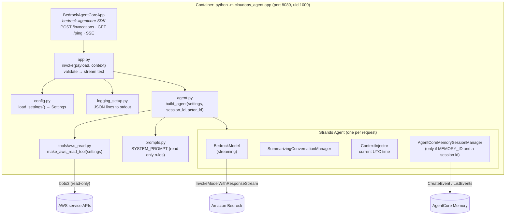
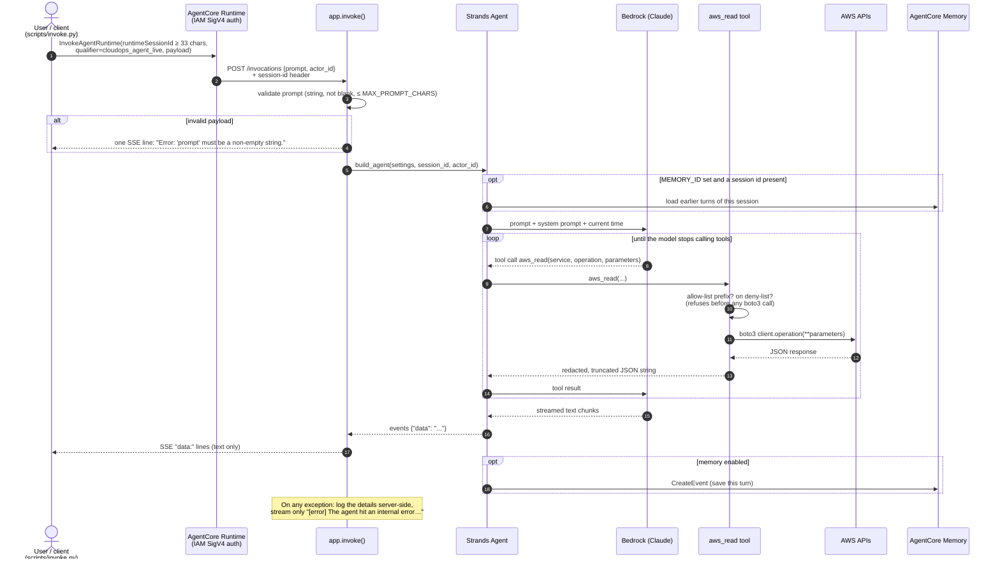
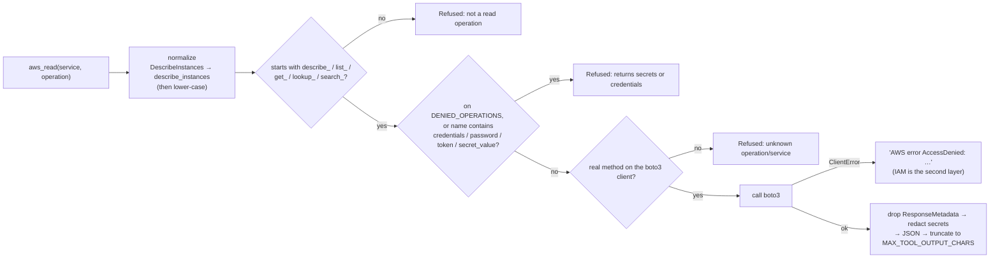
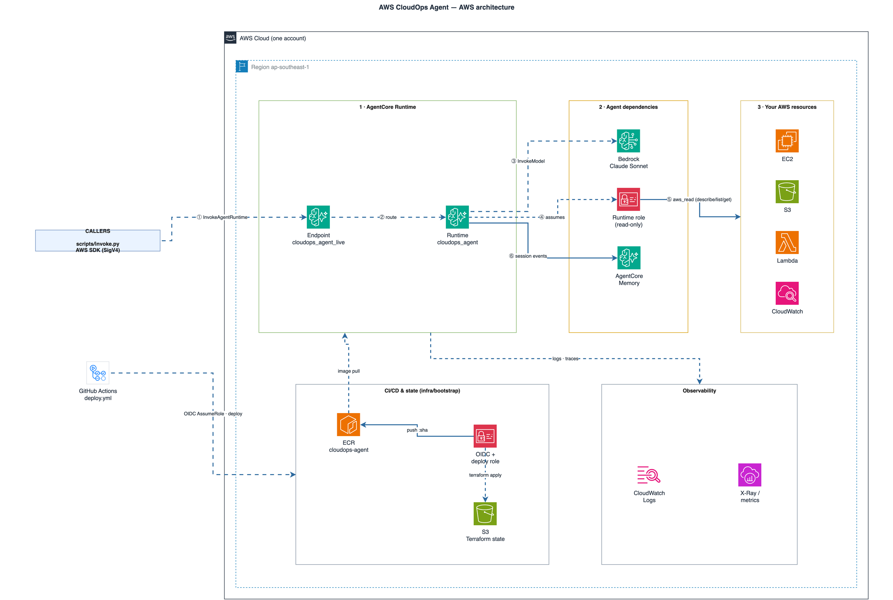
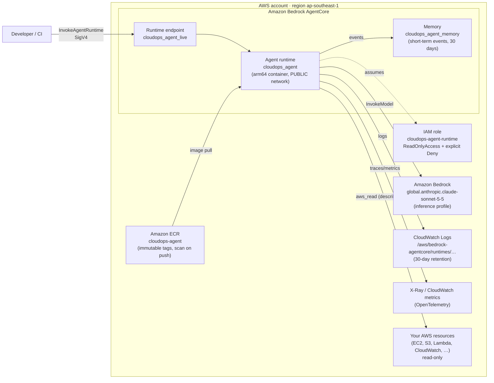
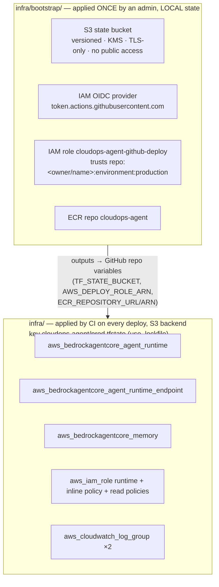

# Onboarding: AWS CloudOps Agent

Welcome. Start here. This page walks you through the system with diagrams. The detailed
reference docs are in [`docs/codebase/`](codebase/).

| If you want to… | Read |
|---|---|
| See which languages, libraries, and tools we use | [codebase/STACK.md](codebase/STACK.md) |
| Find your way around the folders | [codebase/STRUCTURE.md](codebase/STRUCTURE.md) |
| Understand how a request flows and why the design is this way | [codebase/ARCHITECTURE.md](codebase/ARCHITECTURE.md) |
| Write code that matches ours (style, errors, logging) | [codebase/CONVENTIONS.md](codebase/CONVENTIONS.md) |
| Know which AWS services and external systems we touch | [codebase/INTEGRATIONS.md](codebase/INTEGRATIONS.md) |
| Run and write tests | [codebase/TESTING.md](codebase/TESTING.md) |
| Know the risks and sharp edges before you change things | [codebase/CONCERNS.md](codebase/CONCERNS.md) |
| Deploy or configure the agent | [../README.md](../README.md) |
| Look at the AWS architecture diagram with official icons | [diagrams/aws-architecture.drawio](diagrams/aws-architecture.drawio) (open it in [draw.io](https://app.diagrams.net) or the VS Code Draw.io extension) |

---

## 1. What this repo is (in 30 seconds)

- It is a **chat agent for AWS operations**. You ask it things like "why is my Lambda failing?"
  or "how many S3 buckets do I have?". It calls AWS APIs **read-only** and answers in a
  streamed reply.
- It is built with the **Strands Agents** SDK and uses **Claude Sonnet on Amazon Bedrock** as
  its model.
- It runs as an **arm64 container on Amazon Bedrock AgentCore Runtime**. That is a serverless
  host for agents: AWS starts the container on demand, and callers must sign their requests
  with IAM.
- **Terraform** creates every AWS resource, and **GitHub Actions** deploys it from `main` after a
  reviewer approves.
- It is the **base for the team's AI-agents hackathon**. New tool sets, such as Spacelift and
  Slack, plug into `src/cloudops_agent/tools/`.
- Everything under `legacy/` is the old, unmaintained version. It is kept for reference only.

---

## 2. Component diagram (inside the container)



Key points:

- `app.py` is the only HTTP-facing code. `agent.py` decides *what* the agent is made of, and
  `aws_read.py` is the only way the agent can reach AWS.
- A **new agent is built for every request**, so memory is tied to that request's session. The
  settings are loaded **once**, when the module is imported.

---

## 3. Request workflow (one chat message)



---

## 4. How `aws_read` decides (read-only guard)



The agent is read-only because of **two independent layers**:

1. The tool rules shown above.
2. The runtime IAM role. It has `ReadOnlyAccess` plus an explicit **Deny** on secret and data
   reads such as `s3:GetObject`, `ssm:GetParameter*`, `secretsmanager:GetSecretValue`, and
   `dynamodb:GetItem/Query/Scan`.

If you add new tools, do not weaken either layer.

---

## 5. AWS architecture



The image above is rendered from
[`diagrams/aws-architecture.drawio`](diagrams/aws-architecture.drawio); edit it in draw.io.
The same picture as a Mermaid diagram, which renders on GitHub without the image:



All of these are created by Terraform in `infra/`. The exceptions are **ECR** and the
CI/state resources, which come from `infra/bootstrap/` (see §6).
---

## 6. Infrastructure layout (two Terraform configs)



Why are there two? Because of a chicken-and-egg problem. CI needs a role to assume and a bucket
for state, and the runtime needs an image in ECR, before `infra/` can be applied.

---

## 7. Delivery workflow (PR → production)

```mermaid
flowchart LR
    pr["Pull request"] --> ci
    subgraph ci["ci.yml (PRs + pushes to main)"]
        direction TB
        py["python: uv sync · ruff check · ruff format --check · pytest"]
        tf["terraform: fmt · validate (both configs) · trivy HIGH/CRITICAL"]
        sec["secrets: gitleaks over the full git history"]
        dk["docker: arm64 build (no push)"]
    end
    ci --> merge["merge to main"]
    merge --> dep
    subgraph dep["deploy.yml (push to main / manual)"]
        direction TB
        gate{{"environment: production<br/>required reviewer approves"}}
        gate --> auth["OIDC → assume deploy role<br/>(no static AWS keys)"]
        auth --> img["build + push arm64 image<br/>tag = git SHA (skipped if it already exists)"]
        img --> apply["terraform -chdir=infra apply<br/>-var image_tag=SHA"]
    end
    apply --> live["AgentCore creates a new runtime version<br/>endpoint cloudops_agent_live moves to it"]
```



---

## 8. Your first day: a checklist

1. **Install** [uv](https://docs.astral.sh/uv/), Docker (with buildx), Terraform ≥ 1.15, and AWS
   CLI v2.
2. **Clone and test.** No AWS access is needed for this step:

   ```bash
   uv sync
   uv run pytest            # 83 tests, ~1s, no AWS calls
   uv run ruff check . && uv run ruff format --check .
   ```
3. **Run it locally.** You need AWS credentials with Bedrock access in `ap-southeast-1`. Prefer
   a *read-only* profile, because locally the agent uses **your** credentials.

   ```bash
   uv run python -m cloudops_agent.app                     # terminal 1
   uv run python scripts/invoke.py --local                 # terminal 2 (interactive)
   ```
4. **Read the code in this order:** `config.py`, then `app.py`, then `agent.py`, then
   `tools/aws_read.py`. It is about 500 lines in total.
5. **Try a change.** Add a test in `tests/`, watch it fail, make it pass, and open a PR. CI
   runs everything listed in §7.
6. **Talk to the deployed agent**, once you have IAM access to it:

   ```bash
   export AGENT_RUNTIME_ARN=<terraform output agent_runtime_arn>
   uv run python scripts/invoke.py
   ```

## 9. Adding a new tool (the hackathon path)

1. Create `src/cloudops_agent/tools/<name>.py` with a factory `make_<name>_tool(settings) -> AgentTool`.
   Inside it, define a function decorated with `@tool` from `strands`, and give it a clear
   docstring, because the model reads it. Return strings.
2. Register the tool in `build_agent()` in `src/cloudops_agent/agent.py`, in the
   `tools=[...]` list.
3. Inject external clients through the factory, the way `session_factory` works in
   `aws_read`. That lets tests pass in fakes and never call the network.
4. Update `tests/test_agent.py::test_agent_has_only_aws_read_tool`, which pins the tool list.
5. If the tool needs secrets, such as an API token, decide with the team how to provide them.
   There is **no secrets mechanism yet** (see [CONCERNS.md](codebase/CONCERNS.md)).
6. If it needs new AWS permissions, add them to the runtime role in `infra/iam.tf`, as narrow
   as possible.

## 10. Glossary

| Term | Meaning |
|---|---|
| **Strands Agents** | AWS's open-source Python SDK for building agents. It runs the loop of model → tool → model. |
| **AgentCore Runtime** | Serverless host for agent containers. It is invoked with `InvokeAgentRuntime` and gives each session its own microVM. |
| **Runtime endpoint** (`cloudops_agent_live`) | A named pointer to a runtime version. Callers pass it as `qualifier`. |
| **AgentCore Memory** | A managed store of conversation events, keyed by `actor_id` and `session_id`. |
| **Inference profile** (`global.…`) | A Bedrock ID that routes model calls across regions for capacity. |
| **Session id** | The `runtimeSessionId`. It must be **at least 33 characters**. The client generates `cli-<uuid hex>`. |
| **OIDC deploy role** | The IAM role GitHub Actions assumes with a short-lived token. There are no stored AWS keys. |
| **`legacy/`** | The previous implementation (ping monitor, approval Lambdas, RAG, Cognito, Gateway). It is not maintained. |
